# PrediFi Architecture Overview

**Version**: 1.0.0  
**Scope**: Smart Contract Layer, Backend Service, Frontend State Management, and End-to-End Component Interactions.  
**Platform**: Stellar / Soroban (Protocol 23, Soroban SDK 23.5.3)  

---

## Table of Contents

1. [Executive Summary](#executive-summary)
2. [Technology Stack](#technology-stack)
3. [System Component Architecture](#system-component-architecture)
4. [Smart Contract Architecture & Interactions](#smart-contract-architecture--interactions)
   - [Contract Interaction Diagram](#contract-interaction-diagram)
   - [Contract Modules & Responsibilities](#contract-modules--responsibilities)
   - [Ledger Storage Architecture](#ledger-storage-architecture)
5. [Backend API Flow](#backend-api-flow)
   - [Request Lifecycle Sequence Diagram](#request-lifecycle-sequence-diagram)
   - [Backend Subsystems & State Structure](#backend-subsystems--state-structure)
   - [Caching Hierarchy & Invalidation Strategy](#caching-hierarchy--invalidation-strategy)
6. [Frontend State Management](#frontend-state-management)
   - [State Management Architecture Diagram](#state-management-architecture-diagram)
   - [Client-Side Data Flow & Cache Strategy](#client-side-data-flow--cache-strategy)
   - [Session & Persistence Fallback Layer](#session--persistence-fallback-layer)
   - [Transaction Signing & Simulation Lifecycle](#transaction-signing--simulation-lifecycle)
7. [End-to-End Data Flow](#end-to-end-data-flow)
   - [Pool Creation Flow](#pool-creation-flow)
   - [Prediction Staking & Event Indexing Flow](#prediction-staking--event-indexing-flow)
   - [Oracle Price Updates & Automated Resolution](#oracle-price-updates--automated-resolution)
   - [Payout Settlement & Fee Routing Flow](#payout-settlement--fee-routing-flow)
8. [Prediction Market Lifecycle State Machine](#prediction-market-lifecycle-state-machine)
9. [Security Invariants & Reentrancy Guards](#security-invariants--reentrancy-guards)
10. [Monitoring, Telemetry & Observability](#monitoring-telemetry--observability)

---

## Executive Summary

PrediFi is a decentralized, non-custodial prediction market protocol deployed on the Stellar network using Soroban smart contracts. It enables users to create binary and categorical markets, stake positions using whitelisted Stellar tokens (including native XLM and stablecoins), and claim provably fair payouts upon outcome resolution.

The architecture combines on-chain financial guarantees and immutable settlement with a high-throughput, low-latency off-chain indexing and caching layer to power modern, responsive web experiences.

---

## Technology Stack

| Layer | Component | Technology | Purpose |
|-------|-----------|------------|---------|
| **Blockchain** | Network | Stellar Mainnet / Testnet (Protocol 23) | Decentralized settlement and consensus. |
| **Smart Contracts** | Runtime | Soroban WASM (`no_std` Rust, SDK 23.5.3) | Execution of pools, staking, payouts, and access control. |
| **Backend** | Web Framework | Rust, Axum 0.7, Tokio | High-performance asynchronous HTTP and WebSocket server. |
| **Persistence** | Relational DB | PostgreSQL 16 (SQLx) | Indexed relational storage for fast querying of pools and history. |
| **Caching** | Caches | Redis 7 + In-Memory `PoolCache` & `PriceCache` | Hot read caching, rate limiting tokens, and price feeds. |
| **Frontend** | Application | Next.js 15 (React 19, TypeScript, Tailwind) | User-facing responsive web application and wallet interface. |
| **Wallet** | Signer | Freighter Wallet & Stellar SDK | Client-side transaction building, simulation, and cryptographic signing. |
| **Oracles** | Data Feeds | Pyth Network Adapter & Whitelisted Oracles | Real-world price and outcome feeds for automated market settlement. |
| **Telemetry** | Observability | Prometheus & OpenTelemetry (Tracing) | Metrics scraping, request latency profiling, and audit logging. |

---

## System Component Architecture

The diagram below details the operational boundaries and network protocols connecting clients, backend services, external oracles, and the Stellar ledger.

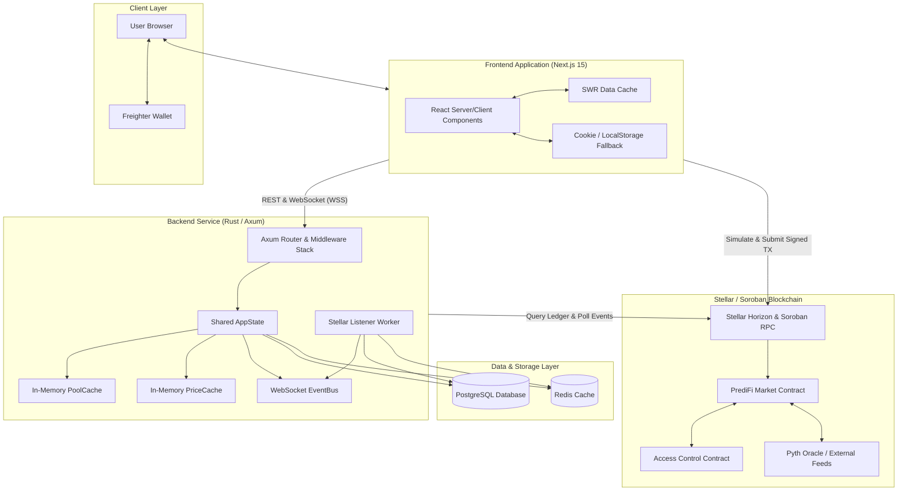

---

## Smart Contract Architecture & Interactions

The contract layer separates administrative authorization from market mechanics to enhance upgradeability, auditability, and principle of least privilege.

### Contract Interaction Diagram

```mermaid
flowchart TD
    subgraph ExternalCallers["External Invocations"]
        AdminUser["Admin Signer"]
        OperatorUser["Operator Signer"]
        OracleFeeder["Oracle Signer"]
        MarketUser["Market Participant (Bettor/Creator)"]
    end

    subgraph AccessControl["access-control Contract"]
        RoleRegistry["Role Registry (Admin=0, Operator=1, Oracle=3)"]
        HasRoleCheck["has_role(address, role)"]
        AdminRoleGuard["require_admin(caller)"]
    end

    subgraph PredifiMarket["predifi-contract"]
        AdminModule["admin.rs (Init, Pause, Timelocked Fees, Whitelist)"]
        PoolModule["pool.rs (create_pool, resolve_pool, cancel_pool)"]
        PredictionModule["prediction.rs (place_prediction, claim_winnings)"]
        PayoutModule["payouts.rs (calculate_payout, odds, protocol fee)"]
        TreasuryModule["treasury.rs (fee collection, withdraw_treasury)"]
        ReferralModule["referral.rs (attribution, referral rewards)"]
        OracleModule["oracle.rs & price_feed.rs (Pyth condition evaluation)"]
        SafeMath["safe_math.rs (overflow-checked math)"]
        RentGuard["RentGuard (reentrancy lockout)"]
    end

    subgraph LedgerStorage["Soroban Storage Tiers"]
        InstanceStorage[("Instance Storage: Config, Whitelist, Paused")]
        PersistentStorage[("Persistent Storage: Pools, Predictions, Stakes, TTLs")]
        TempStorage[("Temporary Storage: Votes, RentGuard")]
    end

    AdminUser --> AdminModule
    AdminUser --> RoleRegistry
    OperatorUser --> PoolModule
    OracleFeeder --> OracleModule
    MarketUser --> PredictionModule
    MarketUser --> PoolModule

    PoolModule -- "Cross-Contract Role Check" --> HasRoleCheck
    OracleModule -- "Cross-Contract Role Check" --> HasRoleCheck
    AdminModule -- "Cross-Contract Role Check" --> HasRoleCheck

    PredictionModule --> RentGuard
    PredictionModule --> PayoutModule
    PredictionModule --> ReferralModule
    PredictionModule --> SafeMath
    PoolModule --> OracleModule
    PayoutModule --> TreasuryModule

    AdminModule --> InstanceStorage
    PoolModule --> PersistentStorage
    PredictionModule --> PersistentStorage
    RentGuard --> TempStorage
```

### Contract Modules & Responsibilities

| Module | Source File | Core Functions & Responsibilities |
|--------|-------------|-----------------------------------|
| **Access Control** | `access-control/src/lib.rs` | RBAC contract defining roles (`Admin=0`, `Operator=1`, `Moderator=2`, `Oracle=3`). Implements safe two-step admin transfer (`propose_new_admin`, `accept_admin_role`) and final admin revocation guard. |
| **Admin & Governance** | `predifi-contract/src/admin.rs` | Protocol initialization with 6 parameters (`init`), emergency pausing (`pause`, `unpause`), 7-day timelocked fee adjustments (`set_fee_bps`, `apply_fee_bps`), token whitelisting, and contract upgrade logic. |
| **Pool Lifecycle** | `predifi-contract/src/pool.rs` | Market pool creation (`create_pool`), staking closure (`close_staking`), cancellation (`cancel_pool`, `emergency_cancel_pool`), and multi-operator consensus resolution (`resolve_pool`). |
| **Prediction & Staking** | `predifi-contract/src/prediction.rs` | Staking execution with token transfer (`place_prediction`), single claim (`claim_winnings`), full principal refunds (`claim_refund`), and multi-market batch claims (`batch_claim_winnings`). |
| **Payouts & Settlement** | `predifi-contract/src/payouts.rs` | Pure mathematical routines: `calculate_claim_payout`, `calculate_referral_amount`, `calculate_odds_bps`. Enforces protocol-favor rounding and Invariant INV-4. |
| **Treasury & Accrual** | `predifi-contract/src/treasury.rs` | Tracks accumulated protocol fees in contract instance storage; provides privileged withdrawal (`withdraw_treasury`) to authorized recipients. |
| **Referrals & Affiliates** | `predifi-contract/src/referral.rs` | Tracks referrer attribution (`Referrer(user, pool)`), accumulates affiliate volume, and routes referral fee shares upon winning claims. |
| **Price Feed & Oracle** | `predifi-contract/src/oracle.rs`, `price_feed.rs` | Pyth Network adapter integration, price feed freshness validation (`is_price_valid`), threshold evaluation (`evaluate_price_condition`), and automated pool resolution (`resolve_pool_from_price`). |
| **Safe Math** | `predifi-contract/src/safe_math.rs` | Arithmetic safety primitives (`checked_add`, `checked_mul`, `checked_div`, `percentage`, `proportion`). |

### Ledger Storage Architecture

Soroban provides three storage tiers with distinct durability and rent profiles:

1. **Instance Storage (Contract-Global)**:
   - Contains immutable configuration: `Config` (treasury address, fee basis points, resolution delay, min duration, max predictions).
   - Operational flags: `Paused` boolean, `TokenWhitelist` list, `PendingFeeBps` proposal with timestamp.
2. **Persistent Storage (Per-Entity Data)**:
   - Market pools: `Pool(pool_id) -> Pool`.
   - Stake records: `Pred(user, pool_id) -> UserPrediction`, `OutStakes(pool_id) -> Vec<i128>`.
   - Claims: `Claimed(user, pool_id) -> bool` (write-once duplicate claim guard).
   - Pagination indices: `UsrPrdCnt`, `UsrPrdIdx`, `ActivePool`, `CatPoolCt`.
   - *TTL Strategy*: Every read/write extends key durability by $535,680$ ledgers (~30 days). Permissionless `renew_storage_ttl(pool_id)` allows community maintenance.
3. **Temporary Storage (Transient State)**:
   - Reentrancy locks: `RentGuard` active flag.
   - Operator voting records: `ResVote(pool_id, operator)` auto-expire after resolution window.

---

## Backend API Flow

The backend service is an Axum web server orchestrating public reads, private administrative endpoints, real-time event streaming, and indexer ingestion.

### Request Lifecycle Sequence Diagram

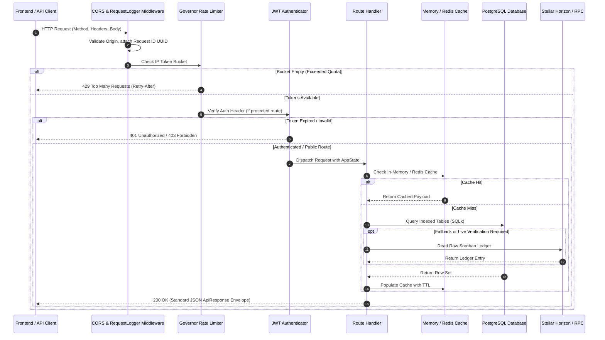

### Backend Subsystems & State Structure

The application state (`AppState`) is cloned across worker threads via `Arc`:

```rust
pub struct AppState {
    pub config: Arc<Config>,
    pub cache: PriceCache,
    pub pool_cache: PoolCache,
    pub redis: RedisCache,
    pub db: Option<PgPool>,
    pub metrics: SharedMetrics,
    pub event_bus: EventBus,
}
```

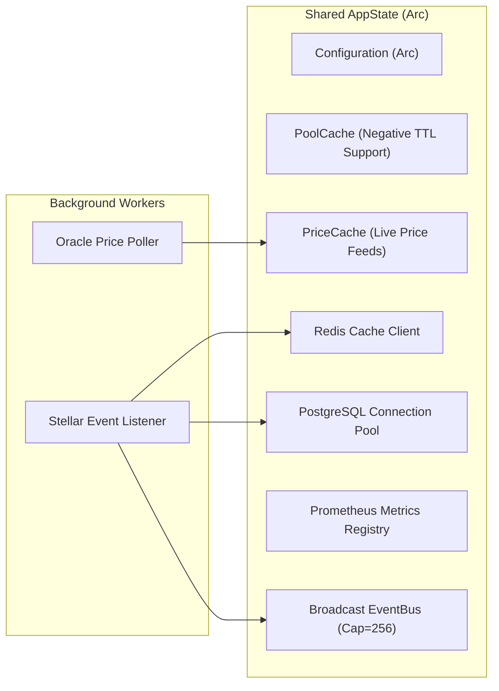

### Caching Hierarchy & Invalidation Strategy

1. **L1 In-Memory Caches**:
   - `PoolCache`: Retains recent pool metadata and live odds. Implements negative caching for non-existent pool queries to prevent database cache stampedes.
   - `PriceCache`: Thread-safe read/write buffer for asset prices updated by oracle pollers.
2. **L2 Distributed Cache (Redis)**:
   - Caches serialized pool listings, category indexes, leaderboard rankings, and stats summaries.
   - Keys: `predifi:pools:active`, `predifi:stats:summary`, `predifi:leaderboard:volume`.
3. **Cache Invalidation**:
   - Ingesting a `prediction_placed` event immediately calls `state.redis.invalidate_stats_cache()`.
   - Resolving a pool purges `PoolCache` and triggers recalculation of leaderboard stats.

---

## Frontend State Management

The frontend architecture combines Next.js 15 App Router server-side capabilities with responsive client-side reactive state.

### State Management Architecture Diagram

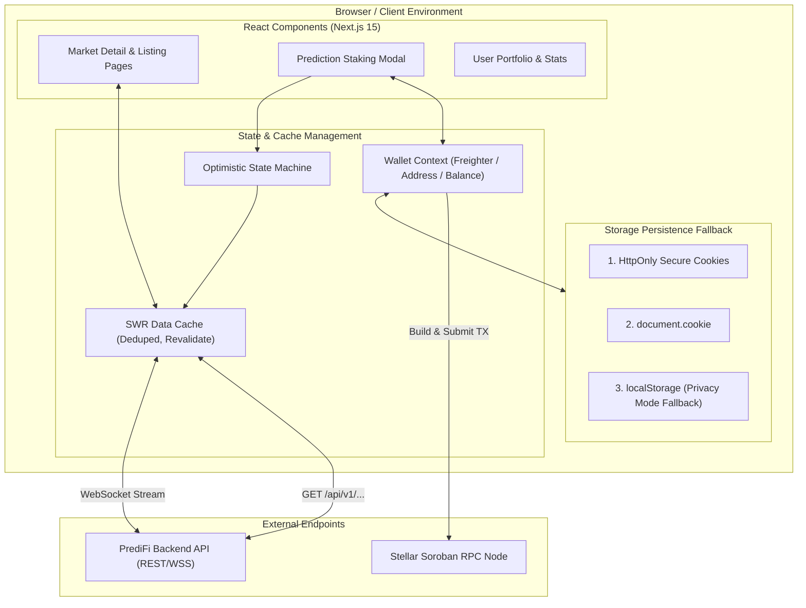

### Client-Side Data Flow & Cache Strategy

- **SWR (Stale-While-Revalidate)**: Drives read queries (`usePools`, `usePoolDetails`, `useMarketPredictions`). Configured with automatic deduplication within 2-second windows and live background revalidation upon window focus.
- **Optimistic Updates**: When a prediction is submitted, the frontend updates user balances and implied outcome odds optimistically while awaiting on-chain confirmation. If the transaction fails during simulation or submission, state rolls back automatically.

### Session & Persistence Fallback Layer

To guarantee functionality across diverse mobile browsers and strict privacy modes (e.g. Brave shields, Safari ITP):
1. **Primary**: Tries reading server-issued `HttpOnly` secure session cookies.
2. **Secondary**: Reads client-accessible `document.cookie`.
3. **Fallback**: If cookies are blocked, falls back to `localStorage` with AES-GCM encrypted session blobs for persistent address and preferences storage.

### Transaction Signing & Simulation Lifecycle

Before requesting user signature in Freighter, all contract interactions execute the standard Soroban simulation protocol:

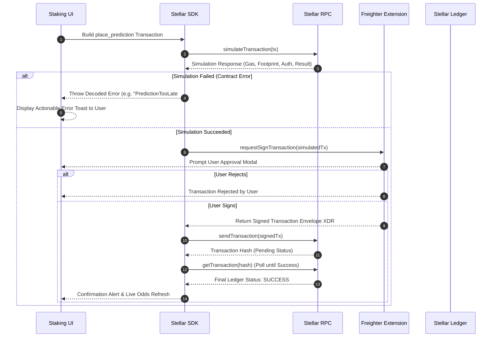

---

## End-to-End Data Flow

### 1. Pool Creation Flow

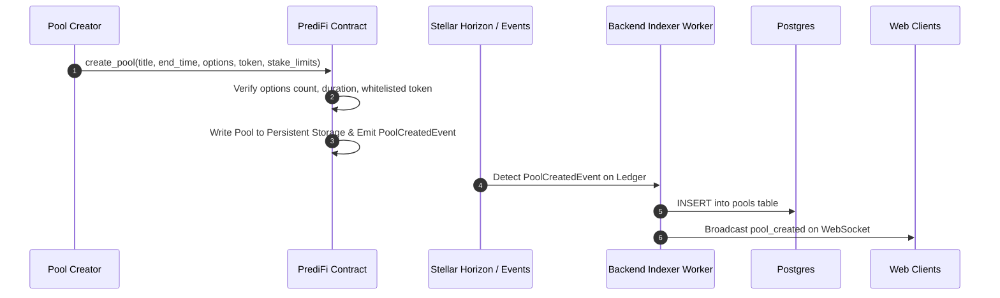

### 2. Prediction Staking & Event Indexing Flow

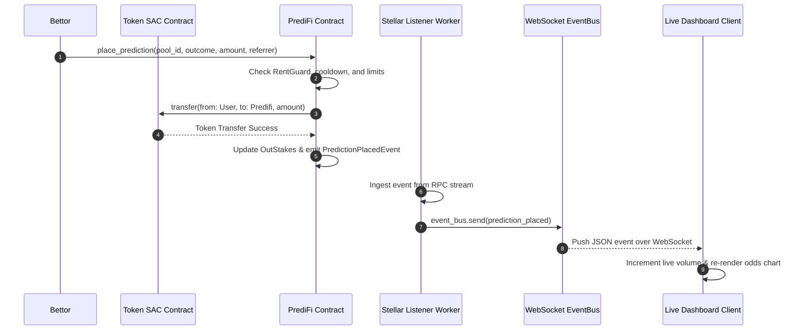

### 3. Oracle Price Updates & Automated Resolution

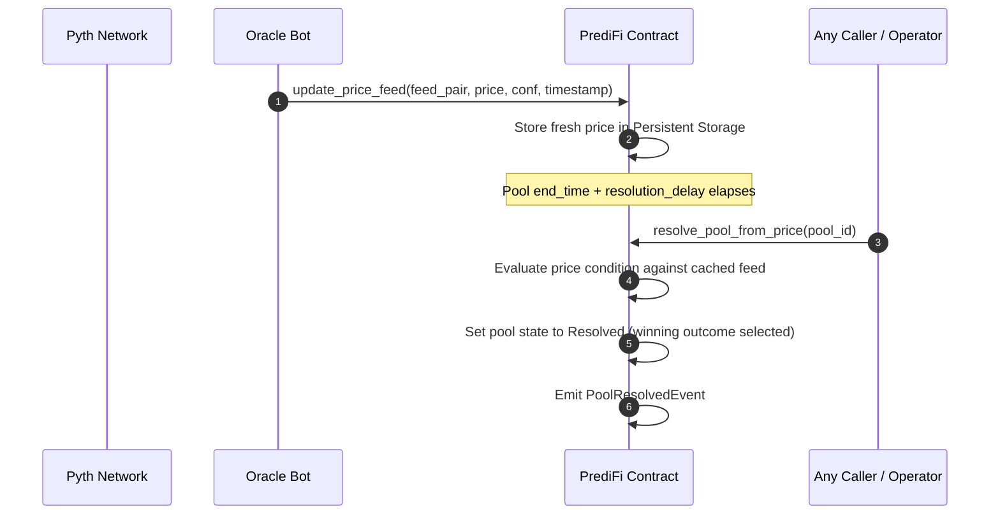

### 4. Payout Settlement & Fee Routing Flow

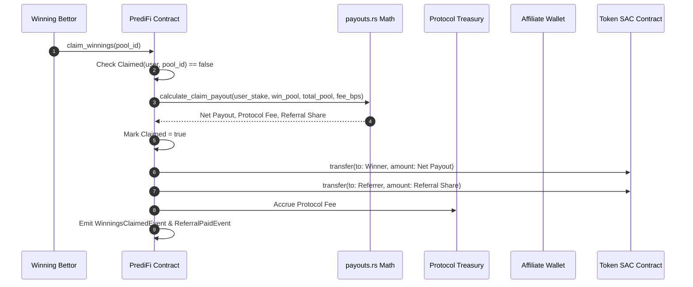

---

## Prediction Market Lifecycle State Machine

A prediction pool progresses through strictly regulated, monotonic states:

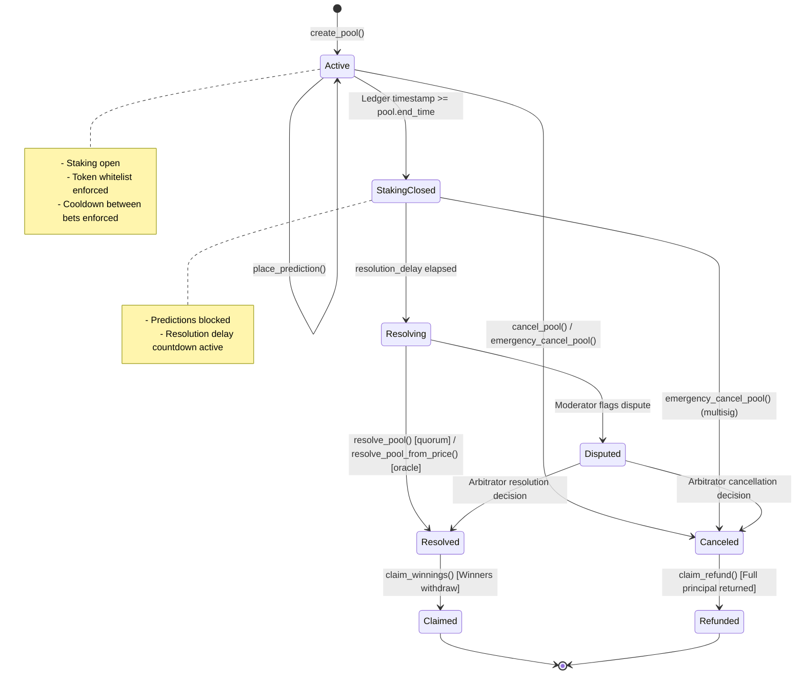

---

## Security Invariants & Reentrancy Guards

PrediFi enforces eight formal protocol invariants verified in unit and integration test suites:

| Invariant | Specification | Enforcement Mechanism |
|-----------|---------------|-----------------------|
| **INV-1** | $\text{Pool Total Stake} = \sum_{i=0}^{N-1} \text{Outcome Stake}_i$ | Checked arithmetic on every `place_prediction`. |
| **INV-2** | No payouts exceed total pool stake vault balance. | Bounded payouts in `payouts.rs` with `RoundingMode::ProtocolFavor`. |
| **INV-3** | Double claims are impossible. | Write-once `Claimed(user, pool_id)` persistent storage key. |
| **INV-4** | $\text{Protocol Fee} + \text{Referral Cut} + \text{Net Winnings} \le \text{Gross Payout}$. | Explicit conservation check prior to token disbursements. |
| **INV-5** | State transitions are irreversible (monotonic). | `MarketState` machine guards (`Active -> Resolved/Canceled`). |
| **INV-6** | Protocol fee basis points $\le 10,000$ ($100\%$). | Parameter validation on `init` and `set_fee_bps`. |
| **INV-7** | Reentrancy attacks are impossible. | `RentGuard` lock acquisition on `place_prediction` and `claim_winnings`. |
| **INV-8** | End time must be strictly greater than creation timestamp. | Minimum pool duration constraint (`min_pool_duration`). |

---

## Monitoring, Telemetry & Observability

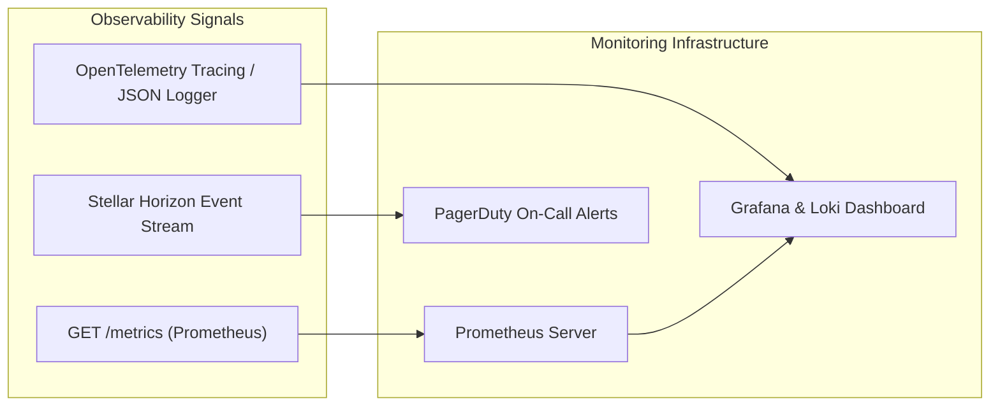

### Metrics & Diagnostic Endpoints

- **`/metrics`**: Exports real-time Prometheus counters and gauges:
  - `http_requests_total{method, path, status}`
  - `http_request_duration_seconds{path}`
  - `db_pool_active_connections`, `db_pool_idle_connections`
  - `websocket_active_clients`
  - `cache_hits_total{cache="pool"|"price"|"redis"}`
- **`/health`**: Evaluates individual subsystem health (`db`, `rpc`, `redis`, `price_cache`). Returns 200 OK if all operational, or 503 Service Unavailable with per-dependency diagnostics.
- **Contract Event Monitoring**: Scrapers watch for high-priority security topics: `unauthorized_resolution`, `unauthorized_admin_op`, `double_claim_attempt`, `contract_paused_alert`.

---

**Document Maintained By**: Web3Novalabs Core Engineering  
**Source Code References**: [predifi-contract](file:///Users/victor/Desktop/Pvsaint/predifi/contract/contracts/predifi-contract/src/lib.rs), [access-control](file:///Users/victor/Desktop/Pvsaint/predifi/contract/contracts/access-control/src/lib.rs), [backend server.rs](file:///Users/victor/Desktop/Pvsaint/predifi/backend/src/server.rs), [frontend api client](file:///Users/victor/Desktop/Pvsaint/predifi/frontend/lib/api/pools.ts)
