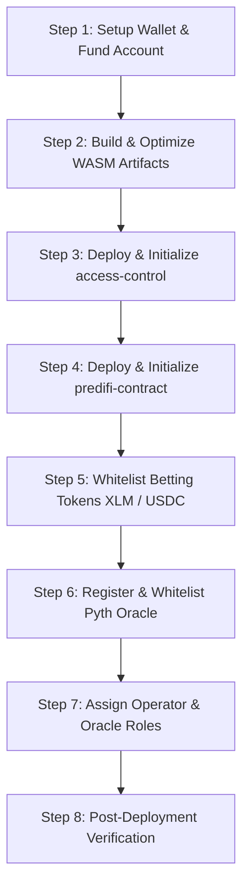

# PrediFi Smart Contract Deployment Guide

**Version**: 1.0.0  
**Target Environments**: Stellar Testnet & Stellar Mainnet  
**Network Protocol**: Protocol 23 (Soroban SDK 23.5.3)  
**Smart Contracts**: `access-control`, `predifi-contract`, `predifi-errors`

---

## Table of Contents

1. [Overview & Deployment Lifecycle](#overview--deployment-lifecycle)
2. [Prerequisites & System Toolchain](#prerequisites--system-toolchain)
3. [Network Configuration](#network-configuration)
4. [Wallet Setup & Key Management](#wallet-setup--key-management)
5. [Contract Compilation & WASM Optimization](#contract-compilation--wasm-optimization)
6. [Step-by-Step Deployment Commands](#step-by-step-deployment-commands)
   - [Automated Deployment (`corrected_deploy.sh`)](#automated-deployment-corrected_deploysh)
   - [Manual Step-by-Step CLI Deployment](#manual-step-by-step-cli-deployment)
7. [Contract Initialization Parameters](#contract-initialization-parameters)
8. [Token Whitelisting](#token-whitelisting)
9. [Oracle Registration & Price Feeds](#oracle-registration--price-feeds)
10. [Role Assignment & Access Control](#role-assignment--access-control)
11. [Post-Deployment Verification](#post-deployment-verification)
12. [State Maintenance & Storage TTL Extension](#state-maintenance--storage-ttl-extension)
13. [Troubleshooting & Recovery](#troubleshooting--recovery)

---

## Overview & Deployment Lifecycle

The PrediFi platform operates on a two-contract modular architecture:
1. **Access Control Contract (`access-control`)**: Acts as the system-wide role registry, granting and revoking roles (`Admin = 0`, `Operator = 1`, `Moderator = 2`, `Oracle = 3`).
2. **PrediFi Contract (`predifi-contract`)**: Governs market pools, staking mechanics, payouts, treasury accruals, referral routing, and oracle resolutions. It queries `access-control` via cross-contract calls.



---

## Prerequisites & System Toolchain

Ensure the following tools are installed on your deployment workstation:

### 1. Rust Toolchain (with WASM Target)
```bash
# Verify Rust installation (Rust 1.84+ recommended)
rustc --version
cargo --version

# Install the WebAssembly compilation target
rustup target add wasm32-unknown-unknown
```

### 2. Stellar CLI
The `stellar-cli` (v22 or later) is the official toolchain for interacting with Soroban smart contracts:
```bash
# Install via Cargo
cargo install --locked stellar-cli --features opt

# Verify installation
stellar --version
```
*(Alternatively, `soroban-cli` can be used; `stellar-cli` is the modernized successor).*

### 3. Binaryen (`wasm-opt`)
`wasm-opt` applies code transformations that drastically reduce bytecode size and ensure compatibility with Soroban gas and storage limits:
```bash
# macOS (Homebrew)
brew install binaryen

# Ubuntu / Debian
sudo apt-get install -y binaryen

# Cargo fallback
cargo install wasm-opt
```

---

## Network Configuration

Configure the official Stellar RPC endpoints and network passphrases in the CLI:

### Testnet Configuration
```bash
stellar network add testnet \
  --rpc-url "https://soroban-testnet.stellar.org:443" \
  --network-passphrase "Test SDF Network ; September 2015"
```

### Mainnet Configuration
```bash
stellar network add mainnet \
  --rpc-url "https://soroban.stellar.org:443" \
  --network-passphrase "Public Global Stellar Network ; September 2015"
```

Verify your configured networks:
```bash
stellar network list
```

---

## Wallet Setup & Key Management

### 1. Generate Deployment Keypair

```bash
# Generate keypair for Testnet
stellar keys generate --network testnet deployer

# Generate keypair for Mainnet
stellar keys generate --network mainnet deployer-mainnet
```

### 2. View Public Address
```bash
stellar keys address deployer
# Example output: GBZXN7PIRZGNMHGA728JAGEL2OC4AHFAXE2XZ2VY5UZWFEXU272K5635
```

### 3. Fund Deployment Accounts

#### Testnet (Friendbot Faucet)
```bash
stellar account fund deployer --network testnet
```

#### Mainnet
For mainnet, transfer native Lumens (XLM) to your public address.
- **Recommended Balance**: Minimum **150 XLM** to comfortably cover bytecode installation, contract instantiation fees, and initial rent reserve TTLs.
- Check balance:
```bash
stellar account balance deployer-mainnet --network mainnet
```

### 4. Key Security Best Practices
- Never commit unencrypted secret keys or `.env` files to git.
- For mainnet operations, consider deploying using a hardware signer or exporting the seed phrase directly into a secure HSM or KMS provider.

---

## Contract Compilation & WASM Optimization

Soroban contracts must be compiled to the `wasm32-unknown-unknown` target in release mode and subsequently optimized.

### 1. Build Workspace Contracts

From the repository root or `contract/` directory:
```bash
cd contract
cargo build --target wasm32-unknown-unknown --release
```

Compiled WASM artifacts will be generated in:
`target/wasm32-unknown-unknown/release/`

### 2. WASM Bytecode Optimization

Run `wasm-opt` to strip dead code and enable bulk memory operations:
```bash
# 1. Optimize access-control contract
wasm-opt -Oz --enable-bulk-memory \
  target/wasm32-unknown-unknown/release/access_control.wasm \
  -o target/wasm32-unknown-unknown/release/access_control_optimized.wasm

# 2. Optimize predifi-contract
wasm-opt -Oz --enable-bulk-memory \
  target/wasm32-unknown-unknown/release/predifi_contract.wasm \
  -o target/wasm32-unknown-unknown/release/predifi_contract_optimized.wasm
```

### 3. Stellar Contract Size Optimization (Optional but Recommended)
```bash
stellar contract optimize \
  --wasm target/wasm32-unknown-unknown/release/access_control_optimized.wasm

stellar contract optimize \
  --wasm target/wasm32-unknown-unknown/release/predifi_contract_optimized.wasm
```

Ensure file sizes remain under the 400 KB limit for Soroban deployments.

---

## Step-by-Step Deployment Commands

### Automated Deployment (`corrected_deploy.sh`)

The repository includes a turnkey script that compiles, optimizes, deploys, and initializes both contracts with all 6 required parameters:

```bash
cd contract
chmod +x corrected_deploy.sh

# Deploy to Testnet using account 'deployer'
./corrected_deploy.sh testnet deployer

# Deploy to Mainnet with customized parameters
TREASURY_ADDRESS="GB..." \
FEE_BPS=100 \
RESOLUTION_DELAY=3600 \
MIN_POOL_DURATION=3600 \
MAX_PREDICTIONS_PER_USER=10 \
./corrected_deploy.sh mainnet deployer-mainnet
```

The script outputs a JSON summary file named `deployed_contracts_<network>_corrected.json`.

---

### Manual Step-by-Step CLI Deployment

If you prefer executing each step manually via the CLI:

#### Step 1: Deploy Access Control Contract
```bash
ACCESS_CONTROL_ID=$(stellar contract deploy \
  --wasm target/wasm32-unknown-unknown/release/access_control_optimized.wasm \
  --source deployer \
  --network testnet)

echo "Access Control Contract ID: $ACCESS_CONTROL_ID"
```

#### Step 2: Initialize Access Control
The `access-control` contract requires the initial administrator address:
```bash
ADMIN_ADDR=$(stellar keys address deployer)

stellar contract invoke \
  --id "$ACCESS_CONTROL_ID" \
  --source deployer \
  --network testnet \
  -- \
  init \
  --admin "$ADMIN_ADDR"
```

#### Step 3: Deploy PrediFi Contract
```bash
PREDIFI_ID=$(stellar contract deploy \
  --wasm target/wasm32-unknown-unknown/release/predifi_contract_optimized.wasm \
  --source deployer \
  --network testnet)

echo "PrediFi Contract ID: $PREDIFI_ID"
```

#### Step 4: Initialize PrediFi Contract (All 6 Required Parameters)
The `predifi-contract` `init` function requires exactly 6 parameters:
```bash
stellar contract invoke \
  --id "$PREDIFI_ID" \
  --source deployer \
  --network testnet \
  -- \
  init \
  --access_control "$ACCESS_CONTROL_ID" \
  --treasury "$ADMIN_ADDR" \
  --fee_bps 100 \
  --resolution_delay 3600 \
  --min_pool_duration 3600 \
  --max_predictions_per_user 10
```

---

## Contract Initialization Parameters

### `access-control` Parameters

| Parameter | Type | Required | Description |
|-----------|------|----------|-------------|
| `admin` | `Address` | Yes | Initial super-administrator address with authority to assign roles and pause the registry. |

---

### `predifi-contract` Parameters

| Parameter | Type | Required | Default | Recommended Value | Description |
|-----------|------|----------|---------|-------------------|-------------|
| `access_control` | `Address` | Yes | - | Deployed `access-control` ID | Address of the role management contract for RBAC cross-calls. |
| `treasury` | `Address` | Yes | - | Secure multi-sig or cold wallet | Address designated to receive protocol fees collected upon winner payout claims. |
| `fee_bps` | `u32` | Yes | 100 | 100 (1%) | Protocol fee in basis points ($100 = 1.00\%$, $250 = 2.50\%$). Maximum is $10,000$ ($100\%$). |
| `resolution_delay` | `u64` | Yes | 3600 | 3600 (1 hour) | Mandatory cooldown period in seconds between `pool.end_time` and the earliest allowed resolution. Maximum is $2,592,000$ (30 days). |
| `min_pool_duration` | `u64` | Yes | 3600 | 3600 (1 hour) | Minimum allowed duration in seconds between pool creation and `pool.end_time`. |
| `max_predictions_per_user`| `u32` | Yes | 10 | 10 | Maximum number of active prediction records a single wallet can place per pool ($0 = \text{unlimited}$). |

---

## Token Whitelisting

Predictions can only be staked using approved tokens. Any attempt to place a bet with an unapproved asset fails with error `TokenNotWhitelisted = 91`.

### 1. Whitelist Native XLM
On Soroban, native Stellar Lumens (XLM) are interacted with through the Stellar Asset Contract (SAC).

- **Testnet Native XLM SAC**: `CDLZFC3SYJYDZT7K67VZ75HPJVIEUVNIXF47ZG2FB2RMQQVU2HHGCYSC`
- **Mainnet Native XLM SAC**: `CAS3J7GYLGXMF6TDJBBYYSE3HQ6BBSMLNUQ34T6TZMYMW2EZH3WOIECU`

Whitelist native XLM:
```bash
stellar contract invoke \
  --id "$PREDIFI_ID" \
  --source deployer \
  --network testnet \
  -- \
  add_token_to_whitelist \
  --admin "$ADMIN_ADDR" \
  --token "CDLZFC3SYJYDZT7K67VZ75HPJVIEUVNIXF47ZG2FB2RMQQVU2HHGCYSC"
```

### 2. Whitelist Stablecoins (e.g. USDC)
```bash
stellar contract invoke \
  --id "$PREDIFI_ID" \
  --source deployer \
  --network testnet \
  -- \
  add_token_to_whitelist \
  --admin "$ADMIN_ADDR" \
  --token "<USDC_SAC_CONTRACT_ADDRESS>"
```

### 3. Batch Whitelist Tokens
To whitelist multiple assets in a single atomic transaction:
```bash
stellar contract invoke \
  --id "$PREDIFI_ID" \
  --source deployer \
  --network testnet \
  -- \
  batch_add_tokens_to_whitelist \
  --admin "$ADMIN_ADDR" \
  --tokens '["CDLZFC3SYJYDZT7K67VZ75HPJVIEUVNIXF47ZG2FB2RMQQVU2HHGCYSC", "CB..."]'
```

### 4. Verify Whitelist Status
```bash
stellar contract read \
  --id "$PREDIFI_ID" \
  --network testnet \
  -- \
  is_token_allowed \
  --token "CDLZFC3SYJYDZT7K67VZ75HPJVIEUVNIXF47ZG2FB2RMQQVU2HHGCYSC"
# Returns: true
```

---

## Oracle Registration & Price Feeds

Automated resolution allows pools to resolve based on price feeds (e.g., Pyth Network).

### 1. Initialize Pyth Oracle Adapter
Configure the price staleness window and confidence bounds:
```bash
stellar contract invoke \
  --id "$PREDIFI_ID" \
  --source deployer \
  --network testnet \
  -- \
  init_oracle \
  --admin "$ADMIN_ADDR" \
  --pyth_contract "<PYTH_CONTRACT_ADDRESS>" \
  --max_price_age 60 \
  --min_confidence_ratio 9500
```
- `max_price_age: 60`: Prices older than 60 seconds are rejected with error `PriceStale = 113`.
- `min_confidence_ratio: 9500`: Price confidence interval must be within 95% ($9500\text{ bps}$).

### 2. Whitelist Authorized Oracle Signer
Register the oracle feeder address allowed to call `update_price_feed`:
```bash
ORACLE_ADDR="G..."

stellar contract invoke \
  --id "$PREDIFI_ID" \
  --source deployer \
  --network testnet \
  -- \
  add_oracle \
  --admin "$ADMIN_ADDR" \
  --oracle_address "$ORACLE_ADDR"
```

### 3. Publish Price Feed Update
Oracles push real-time asset prices:
```bash
stellar contract invoke \
  --id "$PREDIFI_ID" \
  --source "$ORACLE_ADDR" \
  --network testnet \
  -- \
  update_price_feed \
  --feed_pair "XLMUSD" \
  --price 42500000 \
  --conf 50000 \
  --timestamp $(date +%s) \
  --publish_time $(date +%s)
```

---

## Role Assignment & Access Control

Role management is delegated to the `access-control` contract:
- **`Admin = 0`**: Protocol owner (pausing, fees, whitelisting, contract upgrades).
- **`Operator = 1`**: Backend workers and pool managers (resolving pools, closing staking, cancelling broken markets).
- **`Moderator = 2`**: Dispute handling.
- **`Oracle = 3`**: Automated data feeds.

### 1. Assign Operator Role
```bash
OPERATOR_ADDR="G..."

stellar contract invoke \
  --id "$ACCESS_CONTROL_ID" \
  --source deployer \
  --network testnet \
  -- \
  assign_role \
  --admin_caller "$ADMIN_ADDR" \
  --user "$OPERATOR_ADDR" \
  --role "Operator"
```

### 2. Assign Oracle Role
```bash
stellar contract invoke \
  --id "$ACCESS_CONTROL_ID" \
  --source deployer \
  --network testnet \
  -- \
  assign_role \
  --admin_caller "$ADMIN_ADDR" \
  --user "$ORACLE_ADDR" \
  --role "Oracle"
```

### 3. Verify Assigned Role
```bash
stellar contract read \
  --id "$ACCESS_CONTROL_ID" \
  --network testnet \
  -- \
  has_role \
  --user "$OPERATOR_ADDR" \
  --role "Operator"
# Returns: true
```

### 4. Two-Step Safe Admin Transfer
To transfer root contract administration without risk of accidental lock-out:
```bash
NEW_ADMIN_ADDR="G..."

# Step 1: Current admin proposes successor
stellar contract invoke \
  --id "$ACCESS_CONTROL_ID" \
  --source deployer \
  --network testnet \
  -- \
  propose_new_admin \
  --admin_caller "$ADMIN_ADDR" \
  --proposed_admin "$NEW_ADMIN_ADDR"

# Step 2: Proposed admin accepts ownership
stellar contract invoke \
  --id "$ACCESS_CONTROL_ID" \
  --source "$NEW_ADMIN_ADDR" \
  --network testnet \
  -- \
  accept_admin_role \
  --new_admin "$NEW_ADMIN_ADDR"
```

---

## Post-Deployment Verification

### 1. Run Automated Verification Script
The repository provides an automated verification script:
```bash
./contract/scripts/verify_deployment.sh \
  testnet \
  "$PREDIFI_ID" \
  "$ACCESS_CONTROL_ID" \
  "$ADMIN_ADDR"
```

Output:
```text
🔍 Verifying PrediFi deployment on testnet
PrediFi Contract: CB...
Access Control: CD...
Admin: GB...

1. Checking contract existence...
   ✅ PrediFi contract exists
   ✅ AccessControl contract exists
2. Checking treasury address...
   ✅ Treasury address: GB...
3. Checking fee configuration...
   ✅ Fee BPS: 100
4. Checking resolution delay...
   ✅ Resolution delay: 3600 seconds
5. Checking admin role...
   ✅ Admin role confirmed in AccessControl
```

### 2. Create a Test Prediction Pool
Confirm write access and pool creation mechanics:
```bash
END_TIME=$(( $(date +%s) + 7200 ))

stellar contract invoke \
  --id "$PREDIFI_ID" \
  --source deployer \
  --network testnet \
  -- \
  create_pool \
  --creator "$ADMIN_ADDR" \
  --end_time "$END_TIME" \
  --category "Crypto" \
  --title "Testnet Health Verification Pool" \
  --description "Verification market to validate contract deployment" \
  --metadata_url "https://api.predifi.com/meta/1" \
  --options 2 \
  --token "CDLZFC3SYJYDZT7K67VZ75HPJVIEUVNIXF47ZG2FB2RMQQVU2HHGCYSC" \
  --min_stake 10000000 \
  --max_stake 1000000000 \
  --max_total_stake 10000000000
```

---

## State Maintenance & Storage TTL Extension

Soroban uses state archival to reclaim storage fees. Instance and persistent storage entries must have their TTLs periodically extended to avoid archival:

```bash
# Extend contract instance and code TTL by 535,680 ledgers (~30 days)
stellar contract extend \
  --id "$PREDIFI_ID" \
  --source deployer \
  --network testnet \
  --durability persistent \
  --ledgers-to-extend 535680
```

Anyone can also trigger permissionless pool TTL renewal directly via the contract:
```bash
stellar contract invoke \
  --id "$PREDIFI_ID" \
  --source deployer \
  --network testnet \
  -- \
  renew_storage_ttl \
  --pool_id 1
```

---

## Troubleshooting & Recovery

| Issue / Error Code | Root Cause | Solution |
|--------------------|------------|----------|
| `Error(Contract, #1)` | Contract called prior to initialization. | Call `init` on `access-control` and `predifi-contract`. |
| `Error(Contract, #2)` | Contract already initialized. | Do not re-run `init`. Check `deployed_contracts.json`. |
| `Error(Contract, #10)` | Caller lacks required admin/operator role. | Ensure transaction is signed by authorized account. |
| `Error(Contract, #91)` | Token is not whitelisted for betting. | Call `add_token_to_whitelist` with the token SAC address. |
| `Error(Contract, #93)` | Fee BPS exceeds 10,000. | Set `fee_bps` $\le 10,000$ (e.g. 100 for 1%). |
| `Error(Contract, #113)` | Oracle price data is stale. | Call `update_price_feed` with current timestamp before resolving. |
| `wasm-opt: command not found` | Binaryen toolchain missing. | Install binaryen via `brew install binaryen` or `apt-get`. |
| `Transaction expired / timeout` | RPC node lagging or congestion. | Retry transaction or specify higher base fee `--fee 500000`. |

---

**Document Maintained By**: Web3Novalabs Core Engineering  
**Source Code References**: [corrected_deploy.sh](file:///Users/victor/Desktop/Pvsaint/predifi/contract/corrected_deploy.sh), [admin.rs](file:///Users/victor/Desktop/Pvsaint/predifi/contract/contracts/predifi-contract/src/admin.rs), [access-control](file:///Users/victor/Desktop/Pvsaint/predifi/contract/contracts/access-control/src/lib.rs)
